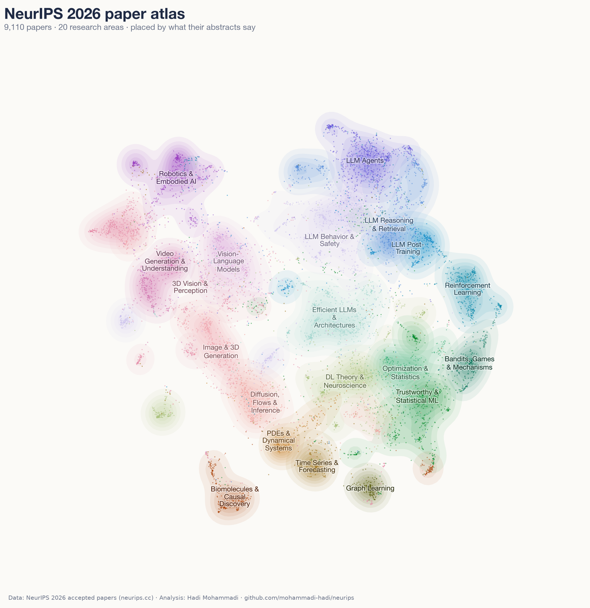
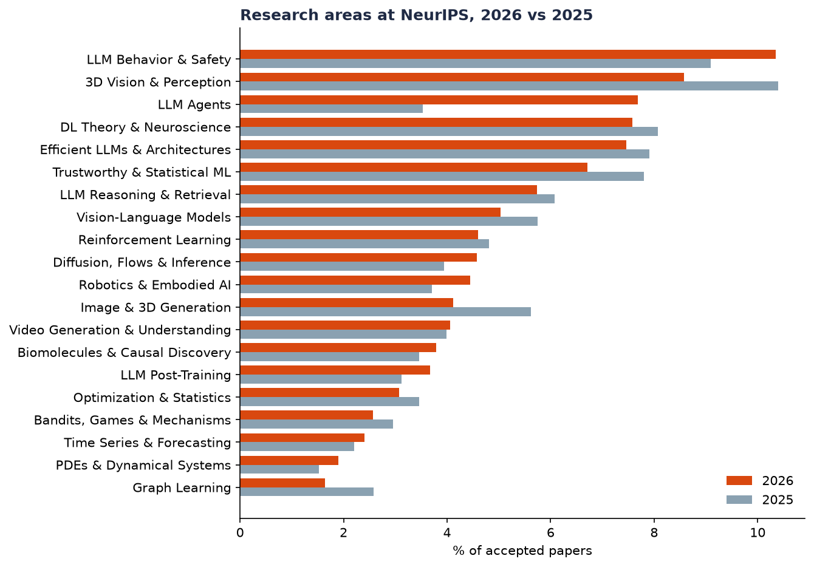
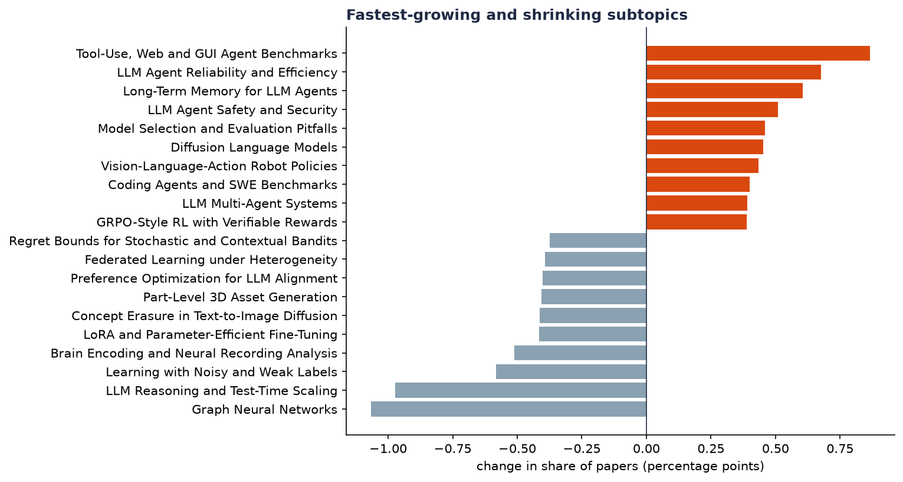
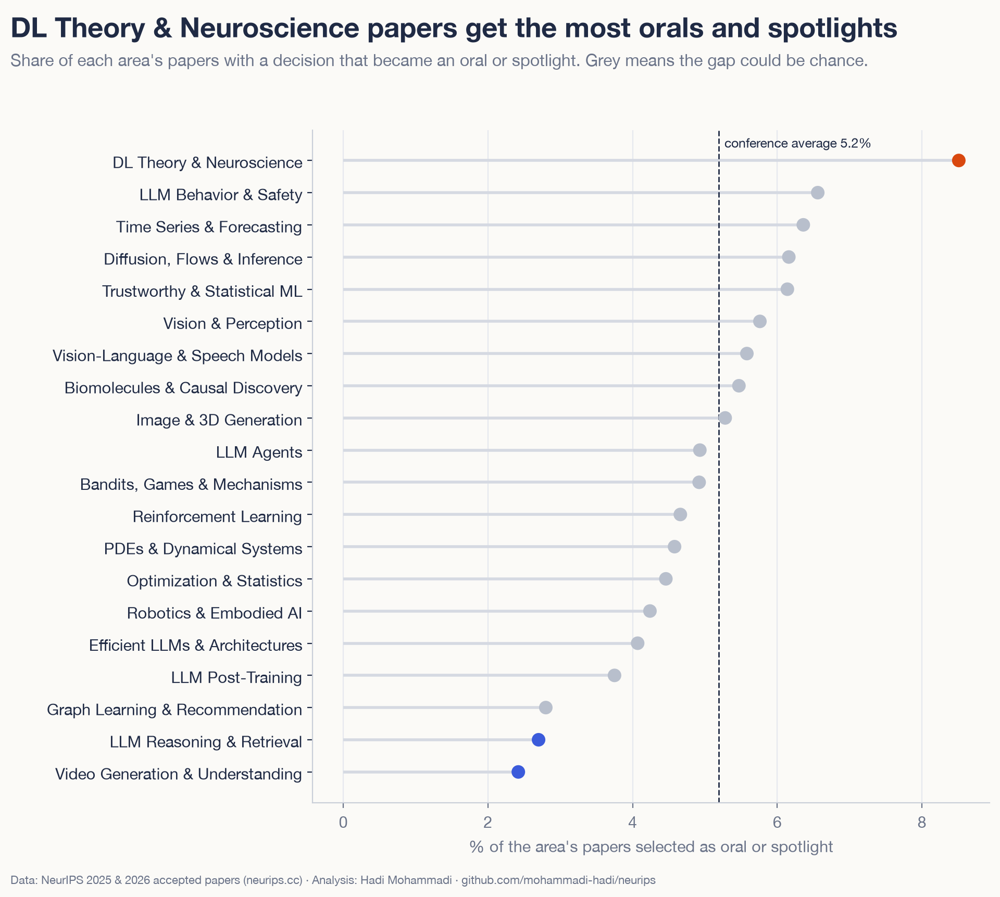
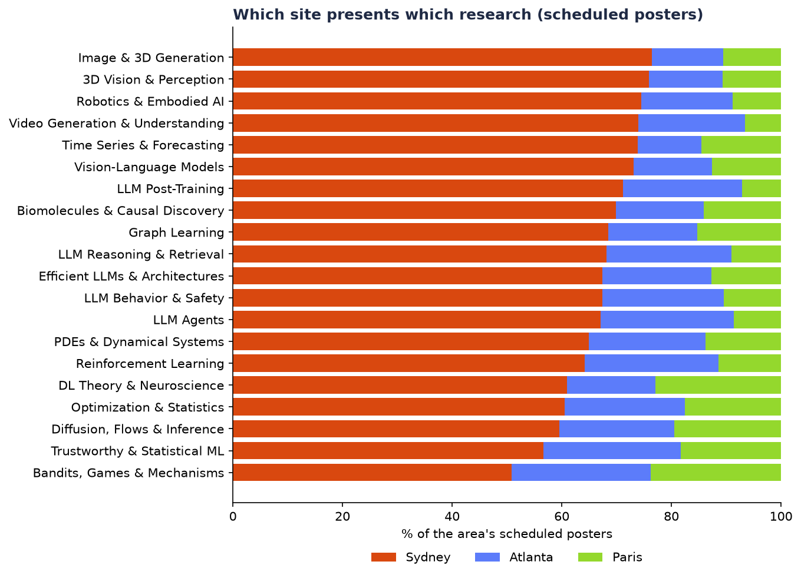
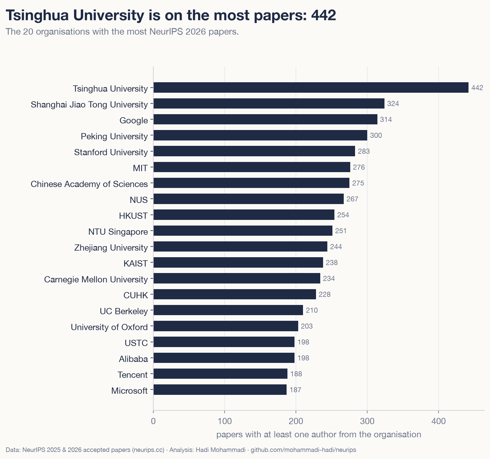

# The NeurIPS 2026 Atlas: what 9,110 papers say about where machine learning is going

NeurIPS 2026 accepted 9,110 papers. Nobody reads 9,110 papers, including the people who review them. So I did the next best thing: I put every title and abstract through an embedding model, grouped them into topics, and compared the result with the 5,859 papers accepted in 2025.

If I had to sum it up in one line: the fastest-growing part of machine learning in 2026 is agents, and how to measure them.

## The short version

- Agents doubled their share. The LLM Agents area went from 3.5% of papers in 2025 to 7.7% in 2026 (700 papers). No other area moved by more than 2 percentage points.
- Six of the ten fastest-growing subtopics are about agents: agent benchmarks, agent reliability, agent memory, agent safety and prompt injection, coding agents, and multi-agent systems.
- "Benchmark" is everywhere. 38% of 2026 abstracts use the word, up from 32% in 2025.
- Some 2025 favourites shrank. Graph neural networks fell from 2.5% to 1.4% of papers, efficient chain-of-thought from 2.5% to 1.5%, and LoRA-style fine-tuning from 1.3% to 0.9%.
- Theory gets the stage. Deep learning theory and neuroscience papers were made orals or spotlights at 8.4%, against 5.2% for the conference as a whole.
- The conference is split across three cities. Of the papers scheduled so far, 67% present in Sydney, 20% in Atlanta and 13% in Paris, and the more theoretical areas lean towards Paris.
- Single-author papers rose from 61 to 282, from 1.0% to 3.1% of all papers.

## How it was made

Everything comes from public data on neurips.cc: the "Download Data" export with titles, authors, affiliations and abstracts for 2026 and 2025, plus the schedule data behind the virtual site, which says whether a paper is an oral, spotlight or poster and in which city it is presented. I pulled it on 20 October 2026.

Each paper's title and abstract was turned into a vector with Qwen3-Embedding-0.6B, an open embedding model that I ran locally. K-means then split the 2026 papers into 150 subtopics, and those were grouped into 20 broader research areas.

One detail matters for every comparison below. The topics were fitted on 2026 papers only. Each 2025 paper was then assigned to its nearest 2026 subtopic. That way both years are measured with the same ruler, and a change in share means the field moved, not that the clustering drew new lines.

A language model proposed a name and a one-line description for each subtopic from its most typical titles, abstracts and distinctive terms. The full list was then checked for overlapping and inconsistent names, and the names are published in the repository so anyone can review them.

Because conference sizes differ (9,110 papers against 5,859), I compare shares of each year's papers, and differences in share are given in percentage points.

You can explore the result yourself in the [interactive atlas](https://mohammadi-hadi.github.io/NeurIPS2026_Analysis/atlas.html): every paper is a dot, you can search by keyword or title, and clicking a dot opens the paper.

## The map

Papers that are close on the map have similar abstracts. The language model work fills the top right: behaviour and safety, agents, reasoning and retrieval, post-training. Vision, video, 3D and robotics sit together on the left. Theory, optimisation, statistics, bandits and graph learning gather in the lower right, and the science-flavoured areas (biomolecules, PDEs, time series) sit along the bottom.

The largest area is LLM Behavior & Safety, with 943 papers, or 10.4% of the conference. It covers interpretability, evaluation, sycophancy, hallucination, jailbreaks and unlearning. Next come 3D Vision & Perception (781), LLM Agents (700), DL Theory & Neuroscience (691) and Efficient LLMs & Architectures (680).

## Which areas grew and which shrank

<!-- interactive: areas_dumbbell -->

LLM Agents is the headline. It held 3.5% of papers in 2025 and 7.7% in 2026, a gain of 4.2 percentage points. The next-biggest gain is LLM Behavior & Safety at 1.3 points. Robotics & Embodied AI (+0.7), Diffusion, Flows & Inference (+0.6) and LLM Post-Training (+0.6) also grew.

The losers are spread more thinly. 3D Vision & Perception lost 1.8 points, Image & 3D Generation 1.5, Trustworthy & Statistical ML 1.1, Graph Learning 0.9 and Vision-Language Models 0.7. Most other areas stayed within half a point of their 2025 share.

Inside the agents area, growth is broad. Every one of its ten subtopics grew its share, and these six moved the most:

| Subtopic | 2026 papers | Share 2025 | Share 2026 |
|---|---|---|---|
| Tool-Use, Web and GUI Agent Benchmarks | 113 | 0.38% | 1.24% |
| LLM Agent Reliability and Efficiency | 88 | 0.29% | 0.97% |
| LLM Agent Safety and Prompt Injection | 76 | 0.32% | 0.83% |
| LLM Multi-Agent Systems | 73 | 0.41% | 0.80% |
| Long-Term Memory for LLM Agents | 66 | 0.12% | 0.72% |
| Coding Agents and SWE Benchmarks | 55 | 0.20% | 0.60% |

Read the names in that table again. Most of them are about whether agents work and whether they can be trusted: how to test them, when they should abstain, how they remember, how they get attacked. A year ago this was a small corner of the conference. Agent memory alone went from 0.1% to 0.7% of papers.

## Subtopic movers

<!-- interactive: treemap -->

The ten fastest-growing subtopics include the six agent topics above. The other four are worth a look too:

- Model Selection and Evaluation Pitfalls, from 0.38% to 0.83%: papers about how benchmarks and model comparisons go wrong.
- Decoding for Diffusion Language Models, from 0.55% to 1.00%: text generated by diffusion instead of one token at a time.
- Vision-Language-Action Robot Policies, from 0.60% to 1.03%: one model that sees, reads instructions and moves a robot.
- GRPO-Style RL with Verifiable Rewards, from 0.32% to 0.71%: the reinforcement learning recipe behind recent reasoning models.

On the shrinking side, the biggest drop is Graph Neural Networks and Foundation Models, from 2.49% to 1.43% of papers. Efficient Chain-of-Thought Reasoning is close behind, from 2.47% to 1.50%. It is still one of the largest subtopics in 2026 with 137 papers, but the rush of 2025 papers on shortening reasoning traces has cooled.

Two staples of LLM fine-tuning also lost ground. LoRA and parameter-efficient fine-tuning fell from 1.31% to 0.90%, and preference optimisation for alignment (the DPO family) from 0.97% to 0.57%. Learning with noisy labels, brain recording analysis, and concept erasure in text-to-image models roughly halved their shares.

None of these topics is disappearing. Graph neural networks still have 130 papers, down from 146, while the conference as a whole grew by more than half. LoRA papers actually rose in number (77 to 82); their share fell because the rest of the conference grew faster.

The [treemap](https://mohammadi-hadi.github.io/NeurIPS2026_Analysis/charts/treemap.html) shows all 150 subtopics at once, sized by paper count and coloured by growth since 2025.

## What the abstracts talk about

<!-- interactive: vocabulary -->

Topic clusters can hide shifts in language, so I also counted how many abstracts mention a set of terms.

"Benchmark" leads. It appears in 38.0% of 2026 abstracts against 32.2% in 2025, a rise of 5.8 points. More than a third of papers now mention benchmarks when describing their work, and the conference is also looking hard at benchmarks themselves: two of this year's orals are "Benchmark Health Index: A Systematic Framework for Benchmarking the Benchmarks of LLMs" and "Leaderboard Hacking: Preference-Based Model Evaluations are Vulnerable to Manipulation".

"Agent" or "agentic" comes second, from 9.3% to 14.4% of abstracts. Smaller rises: safety and alignment (12.6% to 14.5%), flow matching (1.2% to 3.1%) and RLVR or GRPO (2.0% to 3.5%).

One drop is large enough to mention, though I would read it carefully. The words "efficient" or "efficiency" appear in 21.3% of 2026 abstracts, down from 29.2%. Yet the Efficient LLMs & Architectures area barely moved, from 7.9% to 7.5% of papers. So the work on efficiency is still there. What changed is how often abstracts use the word; the data cannot say why. It could also partly reflect differences between the two exports, so I treat it as a secondary observation.

## Where the orals and spotlights went

When the data was pulled, 108 papers were orals and 266 were spotlights, and 1,905 papers had no published decision yet. Of the papers with a decision, 5.2% were orals or spotlights.

The rate differs by area. DL Theory & Neuroscience comes first at 8.4%, followed by Time Series & Forecasting (6.4%), LLM Agents (6.3%), Diffusion, Flows & Inference (6.2%) and Trustworthy & Statistical ML (6.1%). At the bottom are Video Generation & Understanding (2.4%) and LLM Reasoning & Retrieval (2.7%).

Agents, then, are both numerous and highlighted a little above the average rate. The single subtopic with the most orals and spotlights is Human-AI Collaboration and Oversight, with 11 from its 80 papers. Theory subtopics punch above their weight too: PAC Learning and Sample Complexity has 8 orals and spotlights from 48 papers, and Deep Network Theory and Learning Dynamics has 10 from 114.

These rates rest on small numbers. An area with 150 decided papers can move a full point with two extra spotlights, so read the middle of the chart as roughly equal.

## Three cities

<!-- interactive: site_mix -->

NeurIPS 2026 runs in three places. Of the papers in the schedule so far (about 7,200), 67.4% present in Sydney, 19.6% in Atlanta and 13.1% in Paris.

The split is not the same everywhere. Vision is the most Sydney-heavy: Image & 3D Generation (76.4% in Sydney), 3D Vision & Perception (76.0%) and Robotics & Embodied AI (74.6%).

Paris leans theoretical. Bandits, Games & Mechanisms has 23.8% of its papers there and DL Theory & Neuroscience 22.9%, against 13.1% for the conference. Diffusion, Flows & Inference (19.5%) and Trustworthy & Statistical ML (18.3%) follow. Atlanta draws the most from Bandits, Games & Mechanisms (25.4%), Trustworthy & Statistical ML (25.1%), Reinforcement Learning (24.3%) and LLM Agents (24.3%). Bandits, Games & Mechanisms is the most evenly spread area, with only 50.8% of its papers in Sydney.

One caution: 1,919 papers were not yet in the schedule data on 20 October. They are in the topic analysis but missing from these site shares, which may still shift.

## Who wrote the papers

Tsinghua University appears on the most papers (442), followed by Shanghai Jiao Tong University (324), Google (314), Peking University (300), Stanford (283) and MIT (276). Google is the top company. Alibaba (198), Tencent (188), Microsoft (187) and Meta (164) are the next companies on the list.

<!-- interactive: countries -->

A paper counts once for every country on its author list, and shares are computed over papers with at least one mapped affiliation. The United States appears on 45.1% of those papers and China on 34.4%. Hong Kong (8.6%), the UK (8.6%), South Korea (7.2%) and Singapore (6.3%) come next. South Korea grew from 5.3% to 7.2%, with KAIST on 238 papers. China's share is lower than in 2025 (42.2%), but part of that may come from affiliation mapping, which covers fewer 2026 papers (see the caveats).

Industry is less present than a year ago: 24.0% of mapped papers have at least one author from a company, against 27.7% in 2025. Papers written only by industry authors are rare, 2.5%.

Teams are slightly smaller. The mean author count fell from 5.9 to 5.5, the median stayed at 5, and papers with ten or more authors went from 10.1% to 8.9%. At the other end, single-author papers tripled their share, from 1.0% (61 papers) to 3.1% (282).

## Caveats

- **Clusters are a lens.** Many papers sit between topics, and a different number of clusters would draw different boundaries. The shares are a good guide to direction and rough size, less so to the second decimal.
- **Affiliation mapping is partial.** The 1,200 most frequent affiliation strings were merged into canonical organisations with a country and a sector. That covers 97.3% of 2025 papers but 94.4% of 2026 papers, so the country and industry numbers for 2026 rest on a slightly smaller base, and any group that uses many spellings of its affiliation may be undercounted.
- **The two exports may differ.** The 2025 and 2026 downloads may not include exactly the same tracks.
- **The schedule is incomplete.** When the data was pulled, 1,905 papers had no published decision and 1,919 had no city, which affects the oral and spotlight rates and the site split.
- **Names were machine-proposed.** Subtopic names came from a language model and were reviewed by hand. The appendix lists every subtopic with its description so you can judge them.

## Explore it yourself

- [Interactive atlas](https://mohammadi-hadi.github.io/NeurIPS2026_Analysis/atlas.html): all 9,110 papers, searchable, click a dot to open the paper.
- [Subtopic treemap](https://mohammadi-hadi.github.io/NeurIPS2026_Analysis/charts/treemap.html): all 150 subtopics, coloured by growth since 2025.
- [Appendix](https://github.com/mohammadi-hadi/NeurIPS2026_Analysis/blob/main/report/APPENDIX.md): every area and subtopic with descriptions, paper counts, 2025 and 2026 shares and the list of orals.
- [Code and data](https://github.com/mohammadi-hadi/NeurIPS2026_Analysis): the full pipeline, from download to figures.

If you are going to NeurIPS, the atlas is also a quick way to find the posters near your own work.

---

Hadi Mohammadi, AI and data science researcher. Find me at mohammadi.cv.
