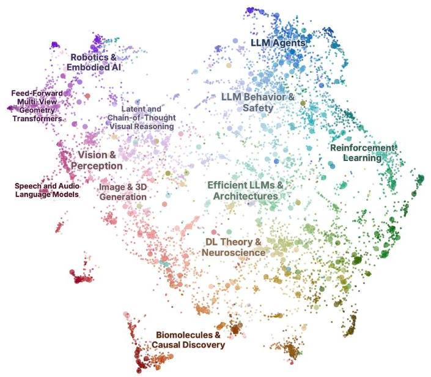
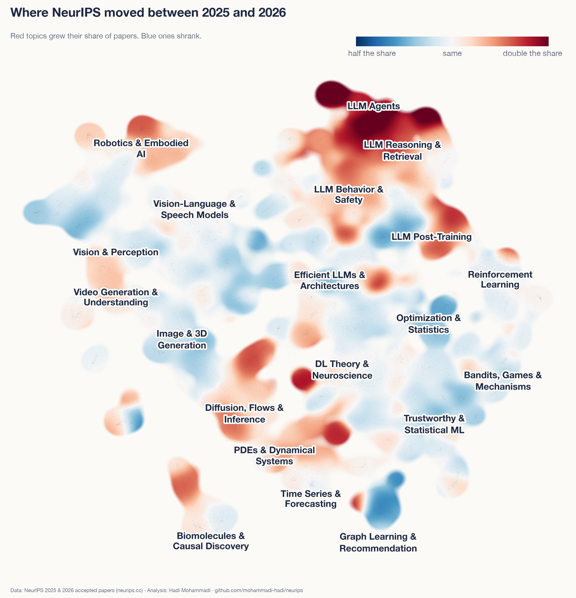
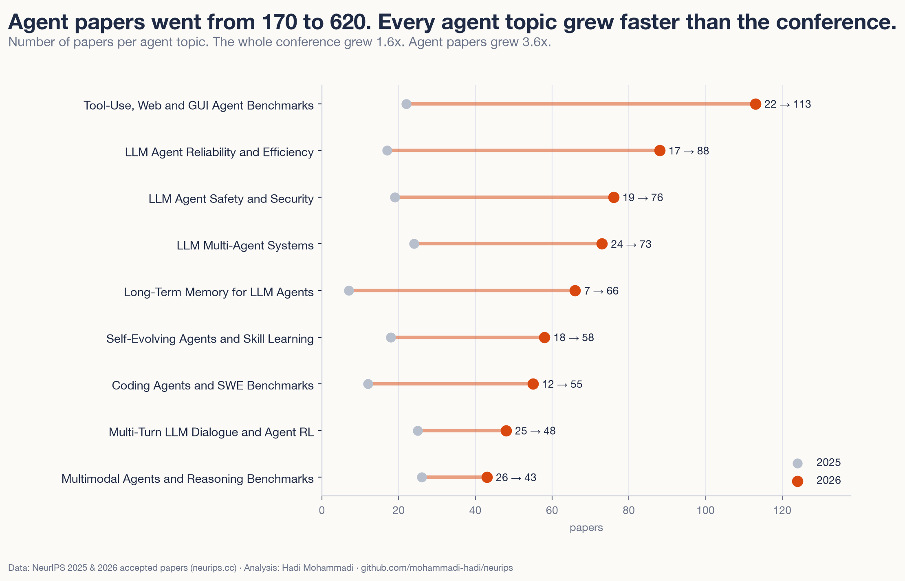
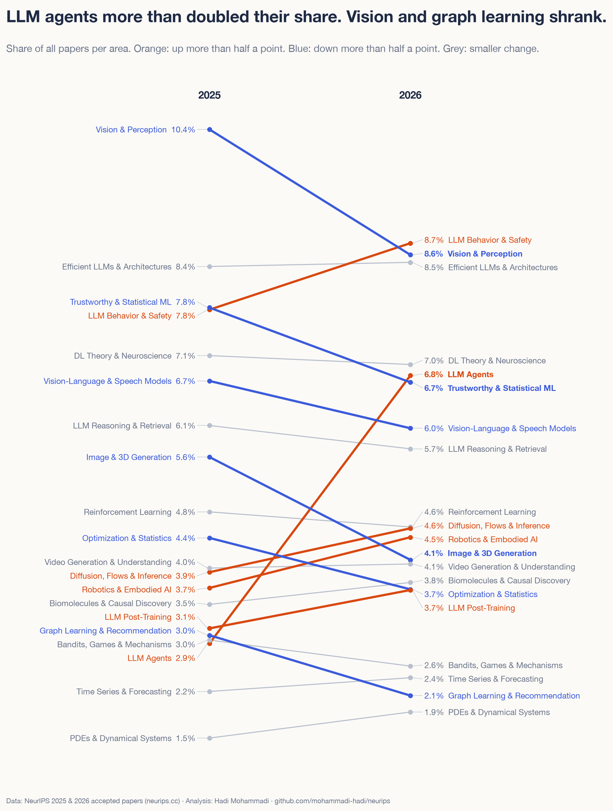
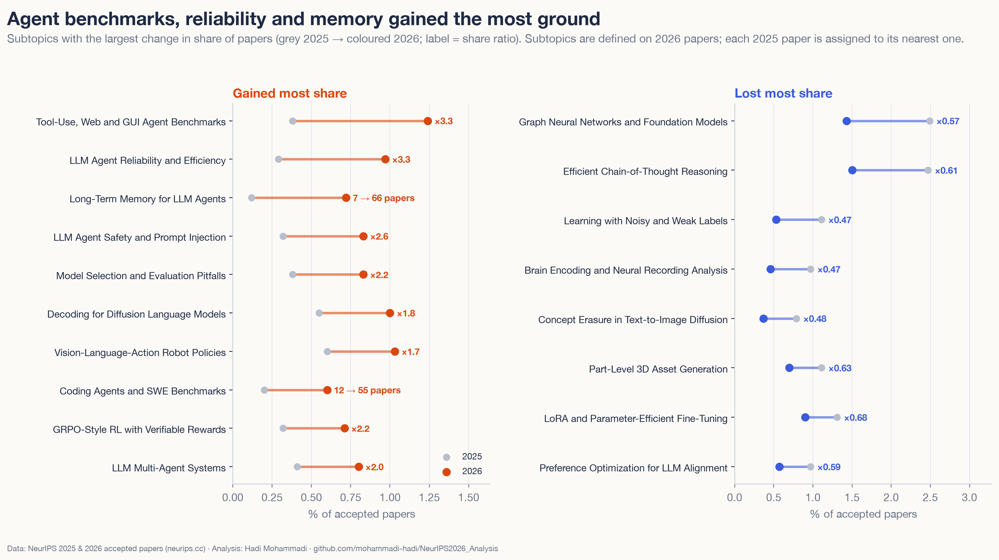
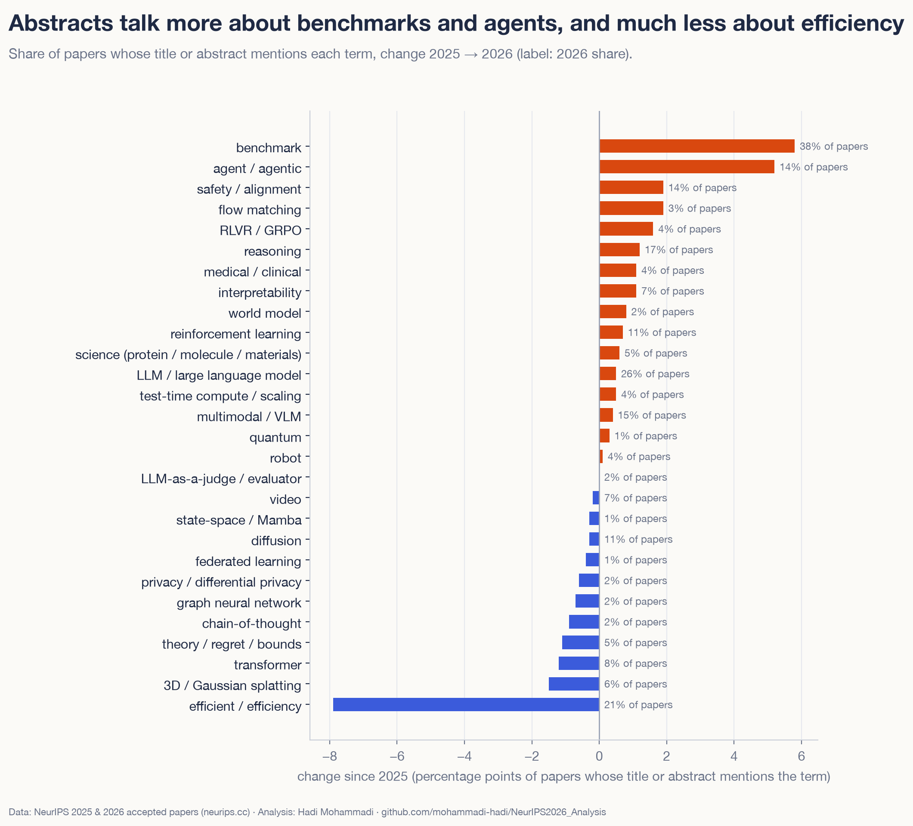
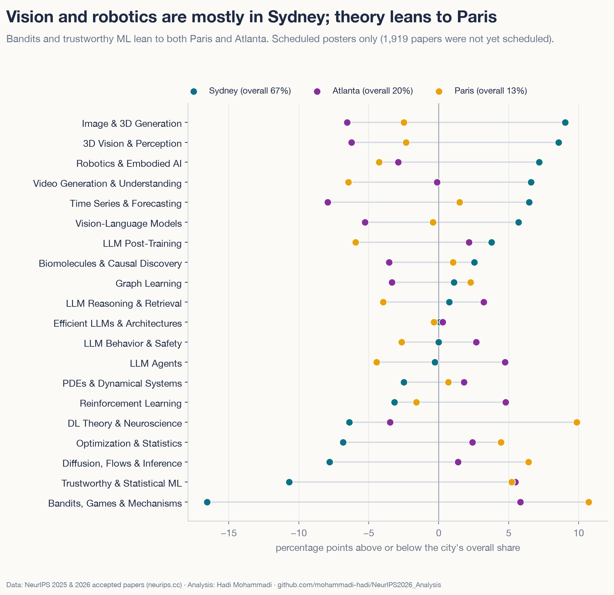
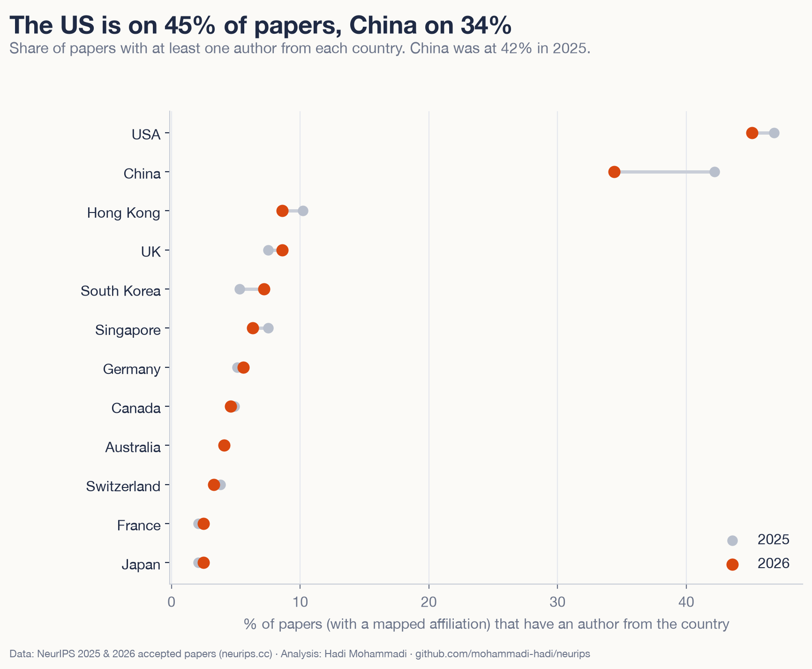

# What 9,110 NeurIPS 2026 papers are about

NeurIPS 2026 has 9,110 papers on its program. That is far too many to read, so I put them all on one map and compared them with the 5,856 papers from 2025.

The big story is agents. Papers about LLM agents more than doubled their share of the conference.

<!-- atlas-hero -->
**[Open the map of all 9,110 papers →](https://mohammadi.cv/neurips/2026/atlas.html)**

## Seven things that stood out

1. LLM agents went from 2.9% of papers in 2025 to 6.8% in 2026. That is 620 papers. No other area moved more than 2 points.
2. Six of the ten topics that gained the most ground are about agents: benchmarks for agents, making them reliable, giving them memory, keeping them safe, coding agents and teams of agents.
3. 38% of abstracts now mention a benchmark. In 2025 it was 32%.
4. Some older topics shrank. Graph neural networks fell from 2.5% to 1.4% of papers, and learning with noisy labels from 1.1% to 0.5%.
5. Deep learning theory and neuroscience gets the most orals and spotlights. Of its papers with a decision so far, 8.5% got one. The average is 5.2%.
6. The conference runs in three cities. Two out of three papers are presented in Sydney, the rest in Atlanta and Paris.
7. Solo papers went from 61 to 282.

## How I made it

All data is public. I downloaded the paper list from neurips.cc on 20 October 2026, with titles, authors, affiliations and abstracts for 2025 and 2026.

An open model running on my laptop (Qwen3-Embedding-0.6B) turned each title and abstract into numbers, so papers about similar things end up close together. I grouped the 2026 papers into 150 small topics and 20 bigger areas. Then I put each 2025 paper into the 2026 topic it is closest to. That way both years are measured with the same ruler.

A language model suggested a name for each topic from its typical titles and words. A second pass named the 20 areas and renamed topics whose names overlapped. You can see all of them in the [appendix](https://mohammadi.cv/neurips/2026/appendix.html).

## The map

Every dot is a paper. Language model work fills the top right. Vision, video, 3D and robotics sit on the left. Theory, statistics and optimisation are in the lower right, and science topics like molecules and time series sit at the bottom.

You can search it, zoom in and click any paper in the [interactive atlas](https://mohammadi.cv/neurips/2026/atlas.html). You can also recolour it by city, by oral or spotlight, by academia or industry, and filter it by the day a poster is shown.

## Where the field moved

Same map, new colours. Red parts grew their share since 2025 and blue parts shrank. The agent corner at the top is the one big red block. Most of vision, statistics and graph learning is blue. These fields did not disappear. The conference grew by more than half (the main track alone by about half), and they grew slower than the rest.

## The agent boom

Agent papers went from 170 to 620. Every one of the nine agent topics grew faster than the conference as a whole.

Look at what these papers are about. Most ask whether agents actually work and whether we can trust them: how to test them, how they remember, how they get attacked, how they learn new skills. The agent memory topic alone went from 7 papers to 66.

## Winners and losers

Besides agents, LLM safety and behaviour grew, and so did robotics. The biggest drops were in vision and perception, image generation, trustworthy ML and graph learning.

<!-- interactive: treemap -->

A few smaller shifts I found interesting:

- Robots that see, read an instruction and act (vision-language-action models) grew from 0.6% to 1.0% of papers.
- Language models that write text by diffusion, instead of one word at a time, grew from 0.5% to 1.0%.

## What the abstracts say

I also counted words in titles and abstracts. "Benchmark" rose from 32% to 38% of papers, and "agent" from 9% to 14%. Some of this year's orals are about benchmarks themselves. One asks how healthy LLM benchmarks are. Another shows how leaderboards can be gamed.

One drop surprised me. "Efficient" or "efficiency" went from 29% of papers to 21%. The area on efficient LLMs barely changed size, so the work is still there. People write the word less. I would not read much into it.

## Three cities

About 67% of papers are presented in Sydney, 19% in Atlanta and 14% in Paris. Vision and robotics lean towards Sydney. Theory leans towards Paris: 22% of the deep learning theory and neuroscience papers are presented there. Bandits and game theory are the most spread out, with only 48% in Sydney.

## Who wrote the papers

Tsinghua University is on the most papers (479), followed by Google (378) and Shanghai Jiao Tong (326). Google is the top company by far.

Of the papers where I could match an affiliation, the US is on 46% and China on 34%. China was at 42% in 2025. A simple count on the raw affiliation text shows the same drop, so it is not a matching problem. South Korea grew from 5% to 7%.

Of those papers, 26% have an author from industry, down from 29%.

## What to keep in mind

- Topics are a lens. Many papers sit between two topics, and other settings would draw the lines a bit differently. I re-ran the topic step two other ways. Agents at least doubled every time, and the biggest drops (vision and perception, image generation, trustworthy ML and graph learning) showed up every time. Smaller changes moved around, and a few flipped.
- 1,905 papers had no oral, spotlight or poster decision yet when I pulled the data.
- Affiliations are messy. I cleaned up the 1,200 most common names and split entries like "MIT/Google" so both count. At least one affiliation matched for 95% of the 2026 papers and 98% of the 2025 ones.
- I checked the topic names against samples of their papers and renamed the ones that did not fit. The [corrections](https://github.com/mohammadi-hadi/neurips/blob/main/data/labels/label_fixes.json) are public.
- About 100 of the 9,110 papers came in through journals like TMLR or the reproducibility challenge, not through NeurIPS's own review.

## Explore it yourself

- [Interactive atlas](https://mohammadi.cv/neurips/2026/atlas.html): every paper on one map. Click a dot for its links.
- [All papers](https://mohammadi.cv/neurips/2026/papers.html): a searchable list with links to each paper.
- [All 150 topics](https://mohammadi.cv/neurips/2026/charts/treemap.html) in one picture.
- [Appendix](https://mohammadi.cv/neurips/2026/appendix.html): every topic with its numbers and every oral.
- [Code and data](https://github.com/mohammadi-hadi/neurips), so you can check my work.
- [EMNLP 2026 atlas](https://mohammadi.cv/emnlp/2026/): the same map for all 5,534 EMNLP papers, and how the two conferences compare.

Every paper links to its NeurIPS page and an arXiv search. NeurIPS has not opened the 2026 papers on OpenReview yet. I will add those links when it does.

If you are going to NeurIPS, the atlas is a quick way to find posters close to your own work.

Hadi Mohammadi · [mohammadi.cv](https://mohammadi.cv)
